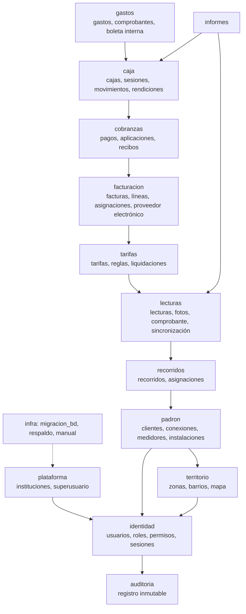
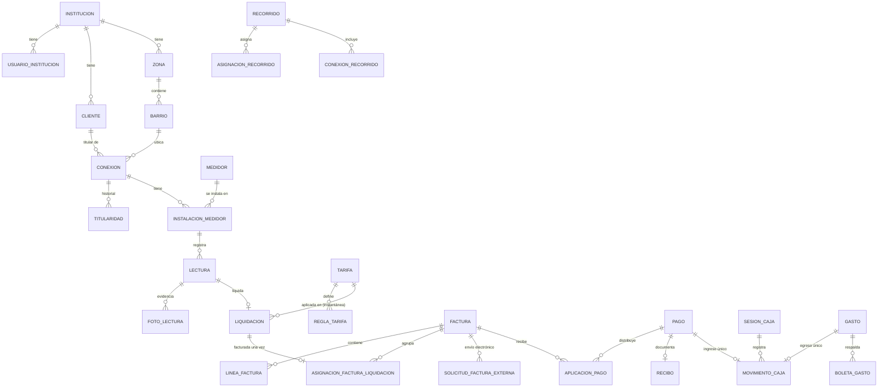

# Koape Aguateras — Propuesta de arquitectura (Fase 0)

Documento de arranque según la sección 25 de `informacion-tecnica.txt`, aplicando `Convenciones-de-Proyecto.txt`.
Fecha: 20/10/2026. Estado: **aprobada**. Decisiones D1–D4 confirmadas el 20/10/2026 (D1: SQLite en desarrollo y PostgreSQL en producción · D2: base central · D3: reutilizar Hotel-Restaurante · D4: VPS Fedora Cloud, `aguateras.koapesystem.com`); detalle en `docs/DECISIONES.md`. Fase 1 implementada.

---

## 1. Resumen de arquitectura

- **Backend**: Django + Django REST Framework, API versionada en `/api/v1/`. Apps separadas por dominio; **las reglas de negocio viven en `servicios.py` de cada app** (las vistas solo validan entrada, llaman al servicio y serializan). Operaciones financieras en `transaction.atomic()` con bloqueo de filas (`select_for_update`) y claves de idempotencia.
- **Frontend**: React + Vite + TypeScript + Tailwind v4, axios. Dos superficies en el mismo proyecto:
  - **Panel administrativo** (escritorio / tableta).
  - **App del cobrador** (PWA móvil, funciona sin conexión: cola local en IndexedDB con fotos, sincronización idempotente).
- **Base de datos**: PostgreSQL + PostGIS en producción (mapas, polígonos de zonas, «conexiones dentro de la zona»). Desarrollo: ver decisión D1.
- **Multiinstitución**: una sola base, **cada registro con su `institucion`** (FK obligatoria), unicidades compuestas `(institucion, código)`, consultas siempre filtradas por la institución de la sesión (nunca por un id enviado por el navegador). Ver decisión D2.
- **Archivos privados** (fotos de medidores, viviendas, comprobantes): fuera de `media/` público, servidos solo por endpoints con permiso.
- **Auditoría**: `RegistroAuditoria` de solo inserción (sin edición ni borrado desde la app), con usuario, institución, acción, entidad, antes/después, IP e id de solicitud.
- **Nada se borra**: configuración se archiva/desactiva; lo operativo y financiero se revierte con movimientos compensatorios que referencian al original.
- **Infraestructura de convenciones** (desde el día uno): Migración SQLite ⇄ PostgreSQL desde el admin, Backup completo (.zip sin `.git`, `venv`, `node_modules`…), Manual de usuario en el admin, usuario admin fijo del instalador, `install.sh` / `start.sh` / `start.bat` + `start.ps1`, todo en castellano. Monitoreo de visitas: **no** aplica (no hay sitio público), salvo que se pida.

## 2. Módulos y dependencias



Regla: un módulo solo depende de los de «arriba»; nunca al revés (facturación no importa nada de caja, etc.).

## 3. Estructura de carpetas

```
AGUATERA-KOAPE/
├── backend/
│   ├── configuracion/            # settings, urls, wsgi/asgi
│   ├── apps/
│   │   ├── plataforma/           # Institucion, configuración por institución, superusuario
│   │   ├── identidad/            # Usuario, Rol, Permiso, AccesoInstitucion, intentos de ingreso, tokens
│   │   ├── auditoria/            # RegistroAuditoria + servicio registrar()
│   │   ├── territorio/           # Zona, Barrio (polígonos)
│   │   ├── padron/               # Cliente, Conexion, Medidor, InstalacionMedidor, historial de titulares
│   │   ├── recorridos/           # Recorrido, AsignacionRecorrido, ConexionRecorrido
│   │   ├── lecturas/             # Lectura, FotoLectura, ComprobanteLectura (PDF), sincronización
│   │   ├── tarifas/              # Tarifa, ReglaTarifa, Liquidacion
│   │   ├── facturacion/          # Factura, LineaFactura, AsignacionFacturaLiquidacion, SolicitudFacturaExterna, RegistroIntegracion
│   │   ├── cobranzas/            # Pago, AplicacionPago, Recibo
│   │   ├── caja/                 # Caja, SesionCaja, MovimientoCaja, RendicionCobrador
│   │   ├── gastos/               # Gasto, AdjuntoGasto, BoletaGasto
│   │   ├── informes/             # consultas de solo lectura
│   │   ├── migracion_bd/         # panel «sin tabla» SQLite ⇄ PostgreSQL
│   │   ├── respaldo/             # panel «sin tabla» de backup .zip
│   │   └── manual/               # manual de usuario en el admin
│   └── comun/                    # base de modelos por institución, permisos DRF, idempotencia, archivos privados
├── frontend/
│   ├── src/
│   │   ├── api/                  # cliente axios, tipos, manejo central de errores
│   │   ├── sesion/               # autenticación, institución activa, permisos
│   │   ├── componentes/          # reutilizables
│   │   ├── paginas/admin/…       # panel administrativo (una carpeta por módulo)
│   │   ├── paginas/cobrador/…    # PWA del cobrador
│   │   └── sincronizacion/       # cola offline (IndexedDB), reintentos, estados
│   └── public/manifest.webmanifest + service worker
├── docs/                         # esta propuesta, DECISIONES.md, API.md
├── install.sh · start.sh · start.bat · start.ps1
└── README.md
```

Nombres en castellano (convención): los nombres en inglés de la especificación (`WaterConnection`, `Meter`…) son orientativos y se traducen (`Conexion`, `Medidor`…), manteniendo la misma separación funcional.

## 4. Modelo entidad-relación inicial



Reglas clave en la base:
- `UNIQUE(institucion, codigo)` en clientes, conexiones, medidores, zonas, barrios, recorridos.
- Una instalación vigente por medidor (`UNIQUE(medidor) WHERE fecha_retiro IS NULL`) y una vigente por conexión.
- Una lectura por instalación y período (`UNIQUE(instalacion, periodo) WHERE estado <> 'anulada'`), más `UNIQUE(institucion, id_operacion_dispositivo)` para la sincronización.
- Una liquidación se factura una sola vez (`UNIQUE(liquidacion) WHERE estado = 'vigente'` en la asignación).
- Un pago genera un único movimiento de caja; un gasto confirmado, un único egreso (`OneToOne` + clave de idempotencia).
- Importes en `DecimalField`; lecturas con precisión según la unidad del medidor; `PROTECT` en todo lo operativo.

## 5. Matriz de roles y permisos (inicial)

| Permiso | Superusuario plataforma | Admin institucional | Cobrador |
|---|:-:|:-:|:-:|
| Crear / suspender instituciones | ✔ | — | — |
| Usuarios y roles de la institución | — (solo auditado) | ✔ | — |
| Clientes, conexiones, medidores | — | ✔ | — |
| Zonas, barrios, mapa completo | — | ✔ | solo su recorrido |
| Recorridos y asignaciones | — | ✔ | ver los suyos |
| Registrar lectura (con foto) | — | ✔ | ✔ (solo asignadas) |
| Corregir / anular lectura | — | ✔ (con motivo) | — |
| Tarifas y vigencias | — | ✔ | — |
| Liquidar y facturar | — | ✔ | — |
| Ver deuda de una conexión | — | ✔ | solo después de confirmar la lectura, en su recorrido |
| Registrar pago | — | ✔ | si se le otorga (D-8) |
| Revertir pago / anular recibo | — | ✔ (con motivo) | — |
| Caja: abrir, cerrar, rendir | — | ✔ | su rendición |
| Gastos referenciales | — | ✔ | — |
| Informes | globales autorizados | ✔ | — |
| Auditoría | plataforma | su institución | — |

Los roles se arman con **permisos granulares** (como en Koape Hotel-Restaurante), así una institución puede crear un rol «Cajero» o «Supervisor» sin tocar código. Cada endpoint verifica: sesión → institución → permiso → estado del registro → flujo → asignación al recorrido.

## 6. Riesgos técnicos

1. **Sin conexión + fotos**: el almacenamiento del navegador es limitado y puede borrarse; se mitiga con `navigator.storage.persist()`, compresión de fotos en el teléfono y avisos de pendientes.
2. **Duplicados por reintento**: toda operación del cobrador lleva un `id_operacion` generado en el teléfono (con generador de respaldo si no hay `crypto.randomUUID`, lección de las convenciones).
3. **Revelado de deuda**: el servidor solo devuelve la deuda si existe una lectura confirmada de esa conexión, en ese recorrido y período, por ese cobrador.
4. **Facturación electrónica**: sin documentación del proveedor no hay adaptador real; se deja la interfaz y un adaptador «no configurado» que nunca simula éxito.
5. **Tarifas**: sin confirmar las modalidades, el motor queda configurable y con pruebas, pero sin reglas inventadas.
6. **PostGIS en Windows** (desarrollo): instalar PostGIS en cada PC es pesado; ver D1.
7. **Datos personales en teléfonos compartidos**: cifrado local, borrado al sincronizar y al cerrar sesión, caducidad de la sesión.

## 7. Decisiones pendientes

**De arquitectura (bloquean la Fase 1):**
- **D1 · Base en desarrollo**: (a) PostgreSQL + PostGIS también en desarrollo; (b) SQLite en desarrollo guardando coordenadas y polígonos como GeoJSON, y PostGIS solo en producción. *Recomendado: (b)* — respeta la convención de «SQLite por defecto» y el módulo de migración; las consultas geográficas pesadas se activan con PostGIS.
- **D2 · Aislamiento**: (a) una base compartida con `institucion` en cada registro; (b) una base por institución, como Koape Hotel-Restaurante. *Recomendado: (a)* — lo pide la especificación y simplifica los indicadores de plataforma.
- **D3 · Reutilización**: copiar y adaptar de Koape Hotel-Restaurante identidad, permisos, auditoría, bloqueo de ingreso, respaldo, migración y scripts de servidor (probados en producción). *Recomendado: sí.*
- **D4 · Despliegue**: mismo VPS Fedora (`/home/webuser/…`) con otro dominio/subdominio, o servidor aparte.

**De negocio (sección 24; no bloquean la Fase 1):** modalidades tarifarias, varias conexiones por cliente, facturación de varias lecturas y parcial, política de aplicación de pagos, proveedor de factura electrónica y su API, modalidad autoimpresa habilitada, vencimientos/mora/recargos/suspensión, si el cobrador cobra en la v1, lecturas sin GPS, y política de archivos locales en los teléfonos.

## 8. Plan de trabajo y entregables por fase

| Fase | Entregable verificable |
|---|---|
| 1. Base | Proyecto Django + React, instituciones, ingreso con código de institución, usuarios/roles/permisos, aislamiento, auditoría, migración BD, backup, manual, instaladores. **Prueba**: dos instituciones no ven datos de la otra. |
| 2. Padrón y mapa | Clientes, conexiones, medidores e instalaciones, zonas y barrios, fotos de vivienda, mapa Leaflet con filtros. |
| 3. Recorridos y lecturas | Asignaciones, flujo del cobrador con foto obligatoria, consumo en el servidor, comprobante PDF, PWA offline con sincronización sin duplicados. |
| 4. Tarifas y liquidaciones | Motor configurable con vigencias e instantáneas históricas. |
| 5. Facturación | Facturas, líneas, asignación a liquidaciones, modalidad por institución, autoimpresa con numeración, adaptador electrónico (real cuando haya documentación), crédito. |
| 6. Pagos y recibos | Pagos parciales, aplicación a varias facturas, recibos, reversiones, saldos. |
| 7. Caja y gastos | Sesiones, movimientos por medio de pago, rendiciones, gastos y boleta interna PDF. |
| 8. Informes e integración | Indicadores, exportaciones, API documentada, credenciales de integración. |

Cada fase se entrega con modelos, migraciones, servicios, permisos, pantallas, pruebas automatizadas (incluidas las 20 obligatorias de la sección 21, según su fase), manual actualizado y `docs/DECISIONES.md`.
